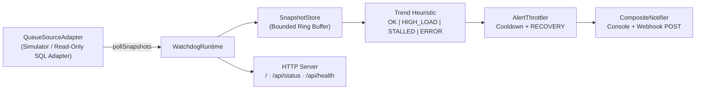

**🇺🇸 English** | [🇧🇷 Português](README.pt-BR.md)

# 📡 Queue Health Watchdog

[](https://github.com/gavicoding/queue-health-watchdog/actions/workflows/ci.yml)
[](https://www.typescriptlang.org/)
[](https://nodejs.org/)
[](package.json)
[](LICENSE)

A **read-only replication and job-queue observability engine** in TypeScript that detects stalled queues using **snapshot trend heuristics**, suppresses alert fatigue via per-node cooldown throttling, sends webhook + recovery notifications, and exposes a live status dashboard.

---

## Why Snapshot Trend Heuristics Matter

Naive queue monitors fire false alarms whenever pending items cross a fixed threshold - even when consumers are healthy and actively clearing a peak-hour burst.

**Queue Health Watchdog** stores a bounded time-series of snapshots per `(nodeId, queueName)` and compares progress across the last `N` polling cycles (`STALLED_WINDOW`):

| Status | Condition | Alert Emitted? |
| :--- | :--- | :--- |
| **`OK`** | `pendingCount < pendingThreshold` and no error | Triggers **`RECOVERY`** if previously alerting |
| **`HIGH_LOAD`** | `pendingCount >= threshold`, **but consumer drained > 0 items** (or queue shrank) in window | No - avoids alert fatigue during normal spikes |
| **`STALLED`** | `pendingCount >= threshold` **and 0 progress** across `STALLED_WINDOW` consecutive cycles | Yes (throttled per `COOLDOWN_MINUTES`) |
| **`ERROR`** | Adapter reported an explicit worker/replication exception | Yes (immediate escalation) |

---

## Architecture



---

## Quick Start

### Run Locally (Built-in Multi-Node Simulator)

```bash
npm install
npm run build
npm start
```

Open **[http://localhost:3080](http://localhost:3080)** for the live auto-refreshing status dashboard, or query the JSON APIs:
- `GET /api/status` - current heuristic evaluation for every node/queue plus recent alert events
- `GET /api/health` - liveness probe (`uptimeSeconds`, `lastRunAt`, `activeIncidents`)

### Run with Docker

```bash
docker compose up --build
```

---

## Configuration (Environment Variables)

| Variable | Default | Description |
| :--- | :--- | :--- |
| `PORT` | `3080` | HTTP server & dashboard port |
| `POLL_INTERVAL_MS` | `5000` | Polling interval in milliseconds |
| `PENDING_THRESHOLD` | `50` | Backlog threshold before evaluating `HIGH_LOAD` vs. `STALLED` |
| `STALLED_WINDOW` | `3` | Number of consecutive stagnant snapshots required to trigger `STALLED` |
| `COOLDOWN_MINUTES` | `60` | Minimum minutes between repeated alerts for the same ongoing incident |
| `WEBHOOK_URL` | *(unset)* | Optional HTTP POST endpoint (Slack/Discord/Teams/custom JSON receiver) |

---

## Extending with a Real Read-Only Database Adapter

Implement the `QueueSourceAdapter` interface in `src/types.ts` with strictly read-only queries (`SELECT ... WITH (NOLOCK)` or read-replica connections) returning `QueueSnapshot[]`, and pass it into `WatchdogRuntime` in `src/index.ts`.

---

## Testing

```bash
npm test
```

Uses Node.js built-in `node:test` runner - tests heuristic classification (`OK`, `HIGH_LOAD`, `STALLED`, `ERROR`), alert cooldown suppression & `RECOVERY` emission, and live HTTP endpoint responses.

---

## License

Apache License 2.0 - see [LICENSE](LICENSE).
