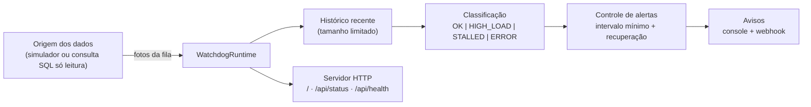

[🇺🇸 English](README.md) | **🇧🇷 Português**

# 📡 Queue Health Watchdog: monitor de filas que separa pico de travamento

[](https://github.com/gavicoding/queue-health-watchdog/actions/workflows/ci.yml)
[](https://www.typescriptlang.org/)
[](https://nodejs.org/)
[](package.json)
[](LICENSE)

Monitor de **filas de replicação e de processamento** escrito em TypeScript. Ele só **lê** (não grava nada no banco), percebe quando uma fila **travou de verdade**, avisa por webhook sem encher a caixa de ninguém e mostra tudo num painel web ao vivo.

---

## Para que serve

O monitor mais comum de fila é assim: "passou de 50 itens pendentes, manda alerta". O problema é que em todo horário de pico a fila passa de 50, mesmo com tudo funcionando. A equipe recebe alerta todo dia, aprende a ignorar e, no dia em que a fila trava de verdade, ninguém olha.

Este monitor não olha só o tamanho da fila. Ele guarda **fotos da fila ao longo do tempo** e confere se os itens **continuam andando**:

| Situação | Quando acontece | Manda alerta? |
| :--- | :--- | :--- |
| **`OK`** | Fila abaixo do limite e sem erro | Não. Se antes havia alerta, manda um aviso de **recuperação** (`RECOVERY`) |
| **`HIGH_LOAD`** (pico) | Fila acima do limite, **mas andando** (itens foram processados ou a fila diminuiu) | Não. É só um horário movimentado |
| **`STALLED`** (travada) | Fila acima do limite e **nada andou** em `STALLED_WINDOW` verificações seguidas | Sim, e não repete o mesmo alerta antes de `COOLDOWN_MINUTES` |
| **`ERROR`** | A origem informou um erro explícito | Sim, na hora |

## O que você ganha

- **Alerta que a equipe leva a sério:** só toca quando há problema de verdade.
- **Sem enxurrada:** o mesmo incidente não gera um e-mail a cada minuto.
- **Sabe quando acabou:** chega um aviso quando a fila volta ao normal.
- **Seguro para produção:** só faz leitura; nunca escreve no banco que está monitorando.
- **Leve:** nenhuma dependência para rodar além do Node.js.

---

## Como funciona



---

## Como usar

### Rodar na sua máquina (vem com um simulador de várias filas)

```bash
npm install
npm run build
npm start
```

Abra **[http://localhost:3080](http://localhost:3080)** para ver o painel, que se atualiza sozinho. Também há duas APIs em JSON:
- `GET /api/status`: situação atual de cada fila e os últimos alertas;
- `GET /api/health`: se o monitor está vivo (`uptimeSeconds`, `lastRunAt`, `activeIncidents`).

### Com Docker

```bash
docker compose up --build
```

---

## Configuração (variáveis de ambiente)

| Variável | Padrão | Para que serve |
| :--- | :--- | :--- |
| `PORT` | `3080` | Porta do painel e das APIs |
| `POLL_INTERVAL_MS` | `5000` | De quanto em quanto tempo a fila é conferida (em milissegundos) |
| `PENDING_THRESHOLD` | `50` | A partir de quantos itens pendentes a fila passa a ser analisada |
| `STALLED_WINDOW` | `3` | Quantas verificações seguidas sem andar para considerar a fila travada |
| `COOLDOWN_MINUTES` | `60` | Tempo mínimo entre dois alertas do mesmo incidente |
| `WEBHOOK_URL` | *(vazio)* | Endereço que recebe os alertas por POST (Slack, Discord, Teams ou o seu sistema) |

---

## Ligando no seu banco de dados

Implemente a interface `QueueSourceAdapter` (em `src/types.ts`) com consultas **só de leitura** (`SELECT ... WITH (NOLOCK)` ou uma réplica de leitura) que devolvam `QueueSnapshot[]`, e passe essa implementação para o `WatchdogRuntime` em `src/index.ts`.

---

## Testes

```bash
npm test
```

Usa o executor de testes nativo do Node.js (`node:test`). Os testes cobrem a classificação (`OK`, `HIGH_LOAD`, `STALLED`, `ERROR`), o intervalo mínimo entre alertas, o aviso de recuperação e as respostas das APIs.

---

## Licença

Apache License 2.0. Veja [LICENSE](LICENSE).
